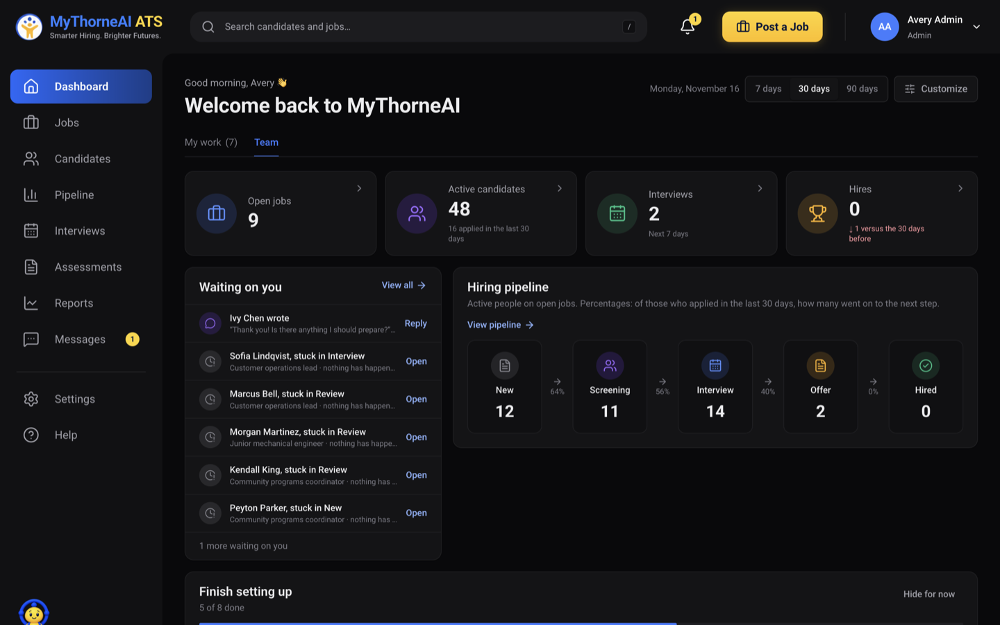
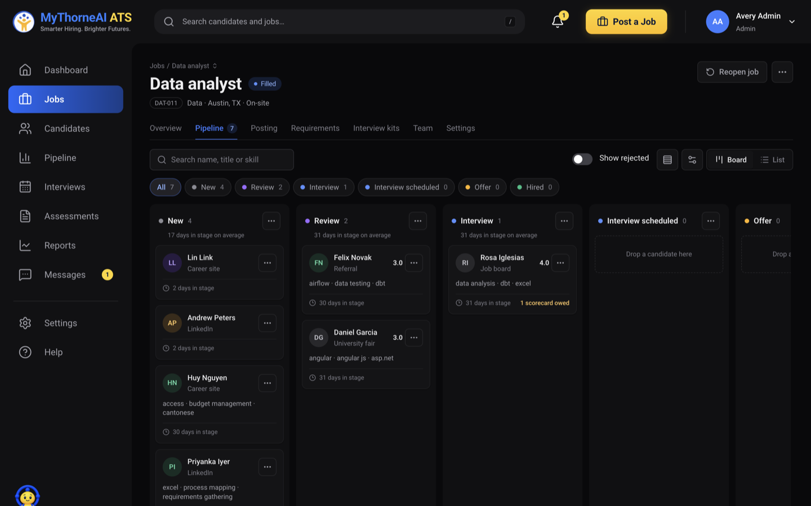
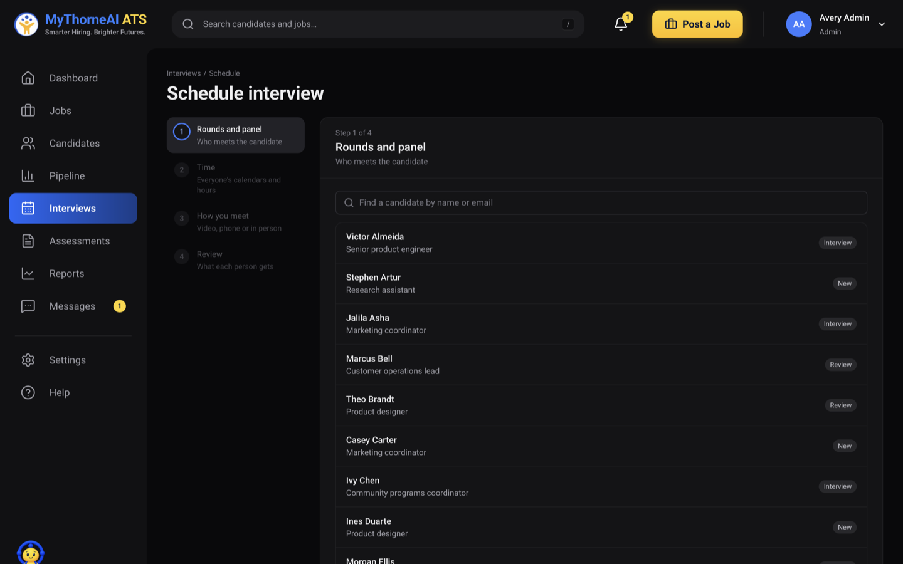
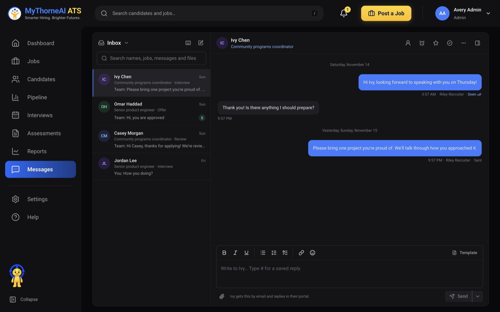
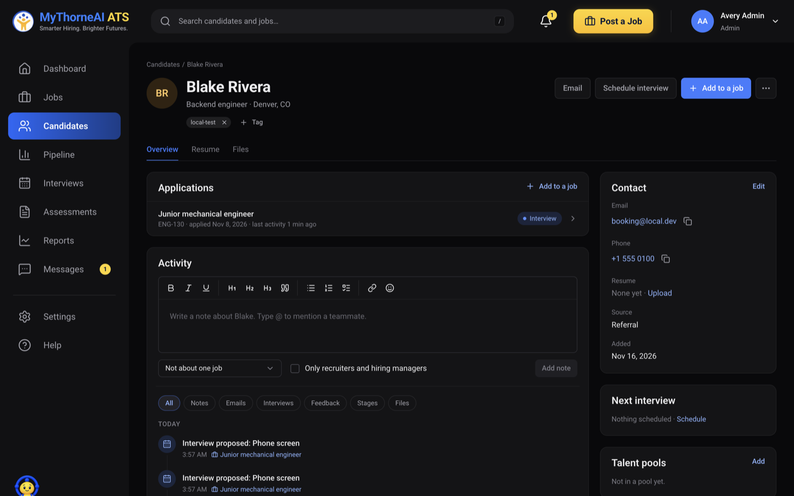
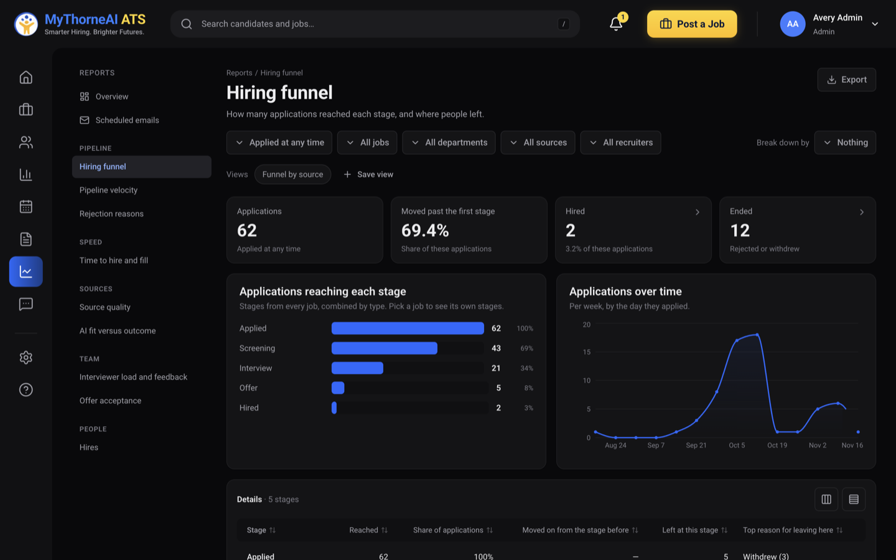
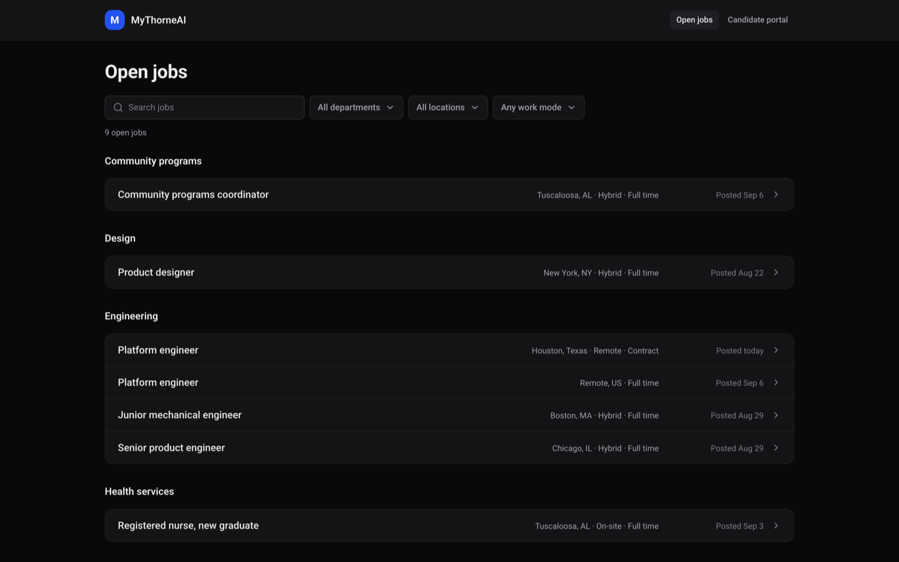
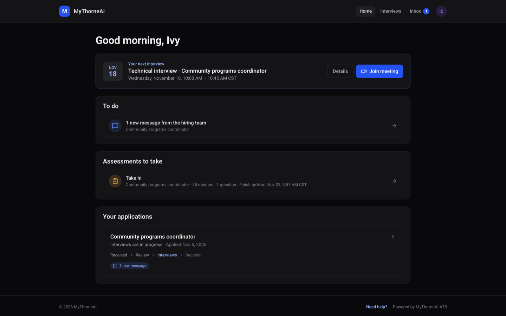

# MyThorneAI ATS

A self-hosted applicant tracking system for one company. Post jobs, read resumes, move people
through a pipeline, schedule interviews, score them the same way every time, send offers, and
let candidates follow along in their own portal.



The source may be read and changed for permitted internal business use. It may not be sold or
redistributed. See the [PolyForm Internal Use License 1.0.0](LICENSE).

## What is inside

| Area             | What you can do                                                                                        |
| ---------------- | ------------------------------------------------------------------------------------------------------ |
| Jobs             | Post a job from a template, get it approved, set the hiring team, change its stages.                   |
| Candidates       | Add people by hand, from a resume or a spreadsheet. Profiles, notes, talent pools, saved views.        |
| Pipeline         | A board for each job. Drag a card to the next stage; an email can go out when they enter it.           |
| Interviews       | A scheduler that knows when everyone is free, self-booking links, kits, a live room, recordings.       |
| Scorecards       | Each interviewer rates the same areas. Feedback locks on submit, so nobody is swayed.                  |
| Offers           | Terms, a letter from a template, approval, and a yes or no from the candidate in their portal.         |
| Messages         | One inbox for every candidate thread. Replies by email land in it. Saved replies and templates.        |
| Assessments      | Quizzes, written answers, file take-homes and code, taken in the portal and graded next to scorecards. |
| Reports          | Pipeline, speed, sources, offers and team, with saved views and scheduled email.                       |
| Careers site     | Your logo, your colours, every open job, and a one-page apply form that reads the resume.              |
| Candidate portal | Each applicant sees their stage, interviews, messages, assessments and offer. Sign-in by code.         |
| Automation       | Workflows that run on events: send an email, send an assessment, add a tag, tell Slack or Teams.       |
| Team             | Roles with exact permissions, single sign-on with WorkOS, activity history, webhooks.                  |

## A look around

**A job and its pipeline.** The board fills the width. Each card shows time in stage and what is
owed.



**Scheduling an interview.** The scheduler shows when each interviewer is free, in their own
time zone, and sends the invites.



**One inbox.** Every candidate thread in one place. Candidates reply from their email or their
portal, and the reply lands in the same thread.



**A candidate.** Who they are, the jobs they are in, and one activity feed with notes.



**Reports.** Pick a report, filter it, save the view, and have it emailed every week.



**What candidates see.** The careers site, and the portal after they apply.





The Help page inside the app has a short how-to with a picture for every task. Every screen is
also in [docs/screenshots](docs/screenshots), in light and dark mode.

## Run it on your machine

You need .NET 10, Node 22 and Docker.

1. Start the database:

   ```bash
   docker compose -f compose.yaml -f compose.dev.yaml up -d database
   ```

2. Start the API with dev sign-in, on port 5080:

   ```bash
   tools/dev-api.sh
   ```

3. Start the web app, on port 3000:

   ```bash
   cd src/web && npm install && npm run dev
   ```

4. Open http://localhost:3000 and sign in as one of the development accounts, for example
   `admin@example.test`. The candidate portal is at `/candidate-portal`; every `@local.dev`
   candidate signs in with the code `123456`.

The API reads `.env` in development. Copy `.env.example` to `.env` and fill in what you use.
Without an OpenAI key, resumes are not read and matching is off; everything else works.

## Check your work

| What                       | How                                                                                                                                  |
| -------------------------- | ------------------------------------------------------------------------------------------------------------------------------------ |
| Web types and format       | `cd src/web && npx tsc --noEmit -p . && npx prettier --check .`                                                                      |
| Web logic checks           | `node --experimental-strip-types src/<path>.check.mjs`, one file per piece of logic                                                  |
| Server tests               | `dotnet run --project tests/server/MyThorneAI.Ats.Api.Tests.csproj` (needs Docker)                                                   |
| Every page, in the browser | `cd src/web && npm run shots`: opens all 130 pages in dark mode, checks each one, saves a screenshot of each into `docs/screenshots` |
| Help page pictures         | `node tools/help-images.mjs`, after a page walk                                                                                      |

The same checks run on every pull request (`.github/workflows/ci.yml`).

## Ship it

Code goes feature branch, then `staging`, then `main`. Each merge publishes images to GHCR and
deploys them to the matching host; production waits for a reviewer. Secrets come from a
self-hosted Infisical over a Netbird mesh. All of it, step by step, is in
[docs/production.md](docs/production.md).

## The public API

`/docs` shows the API that the careers site and the candidate portal use, with Scalar. The
OpenAPI document is at `/openapi/public.json`. In development, `/docs` also shows the full staff
API.

## Where things are

| Path                    | What                                                                         |
| ----------------------- | ---------------------------------------------------------------------------- |
| `src/server`            | The API: ASP.NET Core, EF Core, PostgreSQL.                                  |
| `src/web`               | The web app: Next.js, React, Tailwind. Its rules are in `src/web/CLAUDE.md`. |
| `tests/server`          | Server tests, against a real PostgreSQL in a container.                      |
| `src/web/cypress`       | The page walk.                                                               |
| `deploy`                | Production compose file and deploy script.                                   |
| `docs/product-audit.md` | Why each area looks the way it does.                                         |
| `docs/production.md`    | Hosting, secrets, branch rules, the pipeline.                                |
